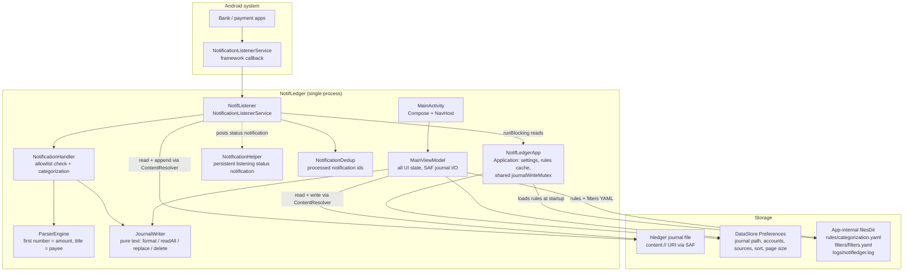
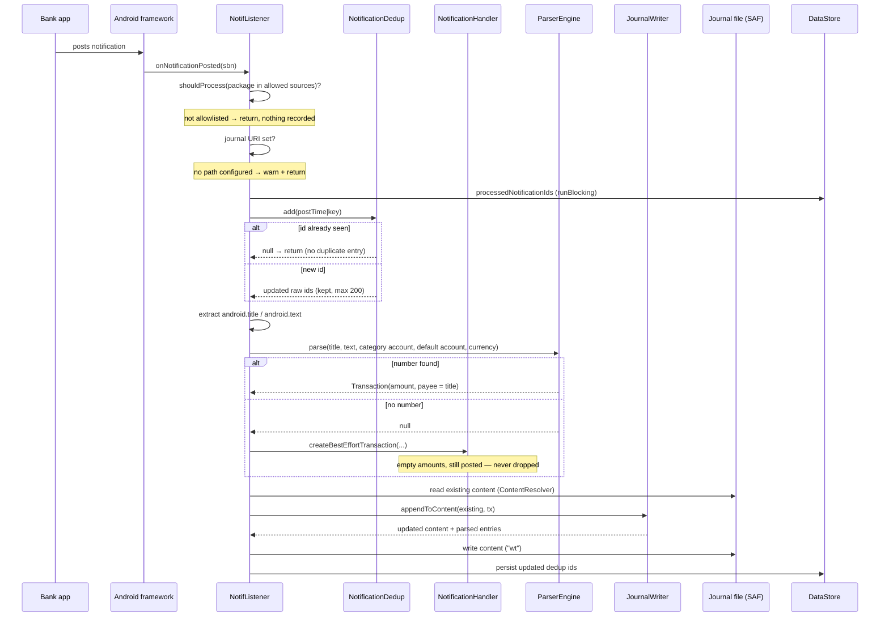
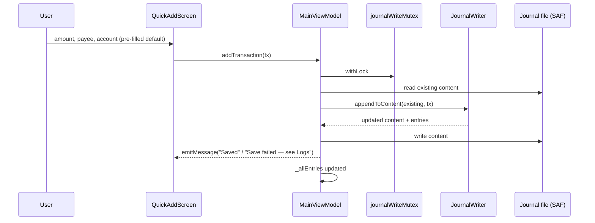
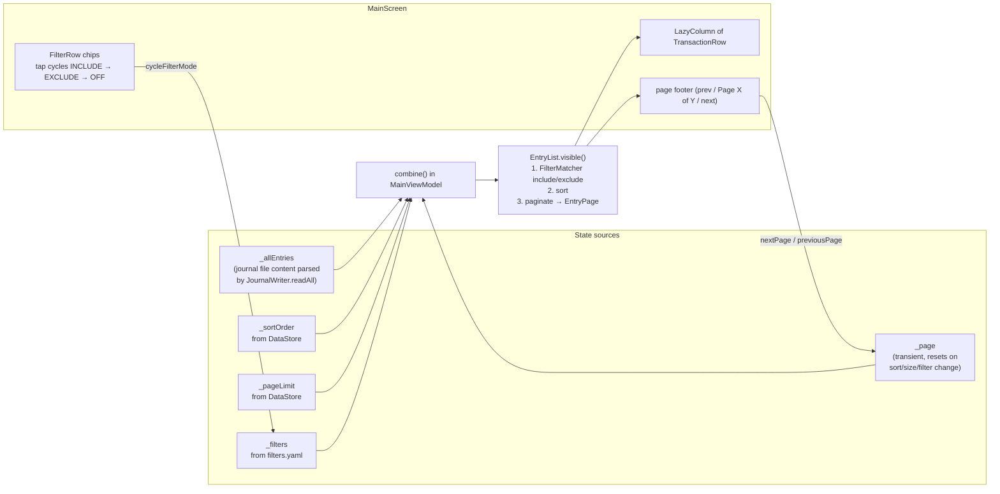
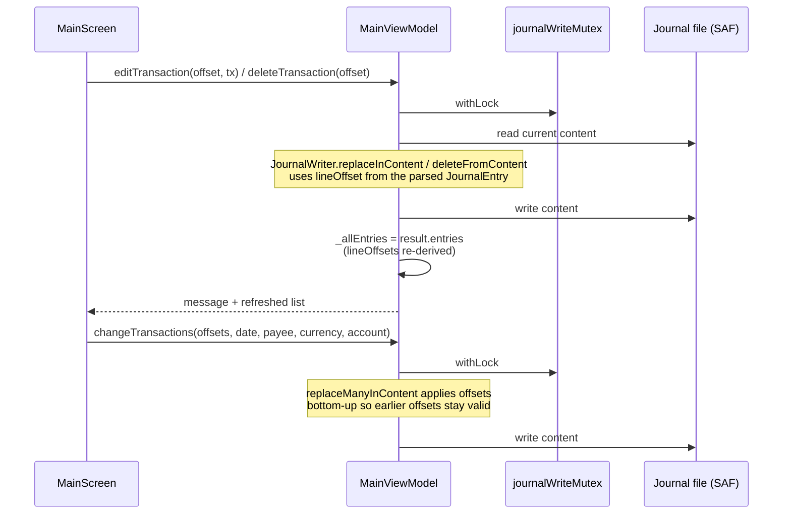
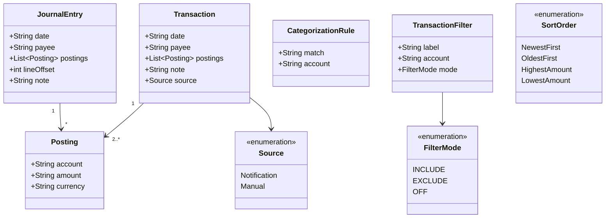
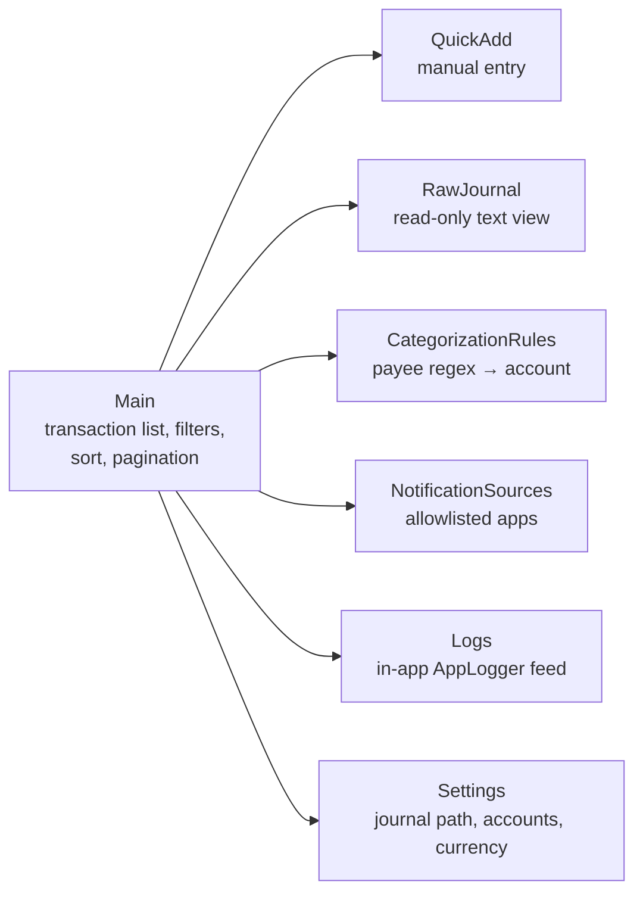
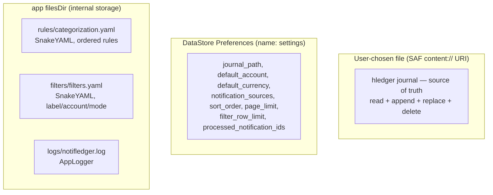

# NotifLedger — Codebase Diagrams

Mermaid maps of how the app works. For the *why* behind the design, read
[design.md](design.md); for code rules, [coding_standarts.md](coding_standarts.md).

## 1. Component overview

No DI framework and no database: `NotifLedgerApp` constructs `SettingsManager`,
the notification path reads settings from it synchronously (`runBlocking`), and
the only durable stores are the journal file, DataStore, and a few YAML/log
files.

## 2. Notification capture flow (automatic path)

Notes:

- The whole read-modify-write runs under `NotifLedgerApp.journalWriteMutex`,
  the same mutex `MainViewModel` uses, so UI edits and notifications can't
  interleave.
- `onListenerConnected` re-posts the status notification and replays
  `activeNotifications` (still in the shade) through the same path, sorted by
  post time — dedup prevents double entries.
- Categorization (`NotificationHandler.matchCategory`) walks the user's rules
  in order, first regex match wins, fallback `expenses:unknown`.
- Raw notification body text is never logged or persisted (design §4.1); only
  the payee/amount end up in the journal.

## 3. Manual quick-add flow

Manual and notification transactions produce the same `Transaction` type and
land in the journal identically — `JournalWriter` doesn't know which path
produced them.

## 4. UI state flow

`EntryList.visible` is pure: filter (include = any posting touches an included
account, exclude = no posting touches an excluded account), sort by
`SortOrder`, slice to one page, clamp out-of-range page numbers.

## 5. Journal edit / delete / bulk change

Entries are addressed by `lineOffset` (line index in the journal), which is why
every write re-parses the whole file and returns fresh `JournalEntry` objects.

## 6. Data model

`Transaction` is what gets written (empty posting amounts are auto-balanced by
`JournalWriter.format`); `JournalEntry` is what gets read back, carrying the
`lineOffset` needed for in-place edits. The `source` field is not persisted in
the journal — once written, entries are indistinguishable.

## 7. Screens and navigation

Routes are defined in `Screen.kt`; `MainViewModel` is the single shared
ViewModel across all destinations (`NotifLedgerNavGraph.kt`).

## 8. Where state lives

- Journal = the only source of truth for transactions (no Room, no cache).
- Rules are cached in `NotifLedgerApp` at process start for the listener path;
  the UI reloads them from disk.
- Dedup state lives in DataStore so listener reconnects don't duplicate
  entries.
