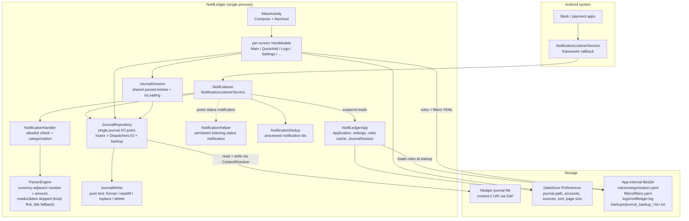
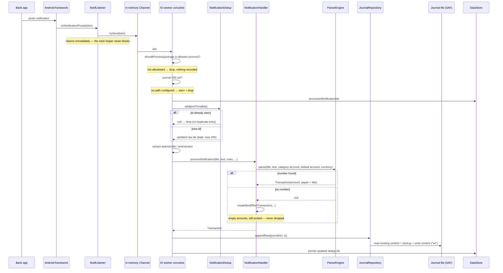
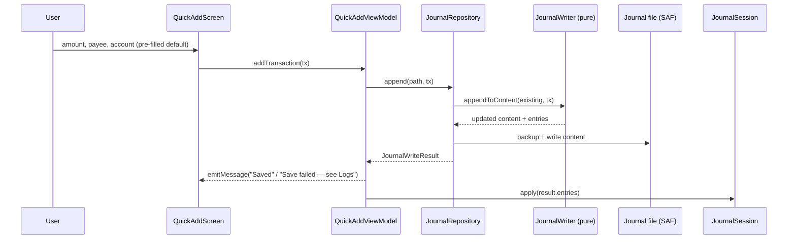
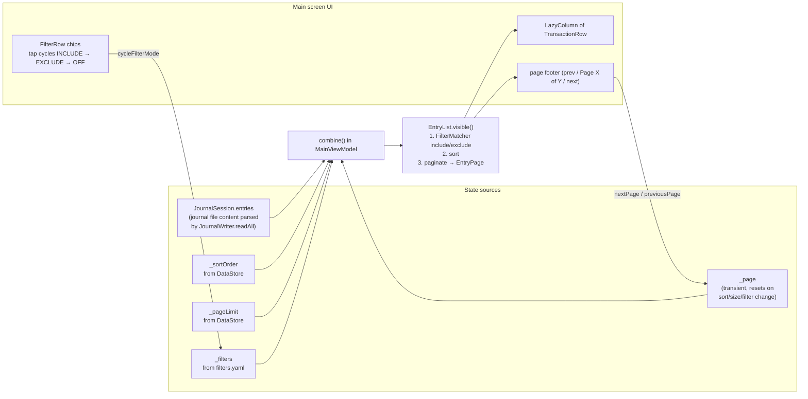
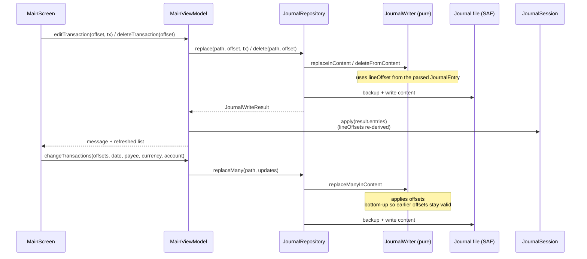
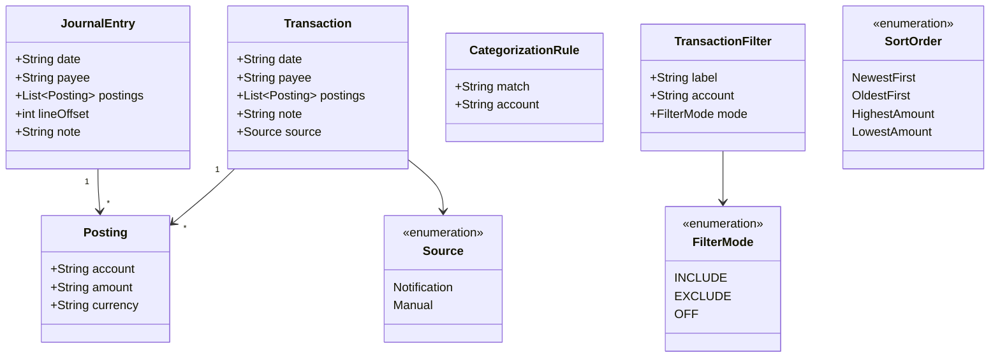
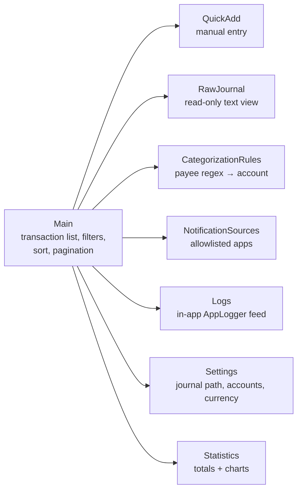
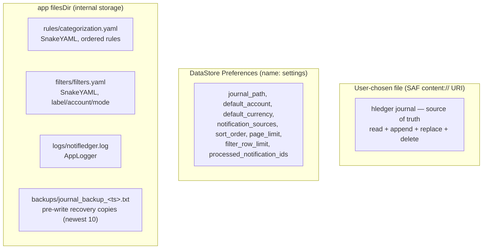

# NotifLedger — Codebase Diagrams

Mermaid maps of how the app works. For the *why* behind the design and the code rules,
read [AGENTS.md](../AGENTS.md).

## 1. Component overview

No DI framework and no database: `NotifLedgerApp` constructs `SettingsManager`,
the notification path reads settings from it through suspend getters, and
the only durable stores are the journal file, DataStore, and a few YAML/log
files. Both the listener and the UI ViewModels reach the journal only through
`JournalRepository`, which serializes every read-modify-write with its own
mutex, runs the ContentResolver work on `Dispatchers.IO`, and keeps the newest
10 timestamped `backups/journal_backup_<ts>.txt` recovery copies from before
each write.

## 2. Notification capture flow (automatic path)

Notes:

- `onNotificationPosted` only enqueues into an in-memory `Channel`; ONE IO
  worker coroutine consumes it, so the main looper never blocks. Dedup,
  parsing, and `JournalRepository.appendRaw` all run in that worker
  (`handleNotification` is `suspend`).
- `JournalRepository` serializes the read-modify-write with its own mutex —
  the same one the ViewModel path goes through — so UI edits and notifications
  can't interleave.
- `onListenerConnected` re-posts the status notification and replays
  `activeNotifications` (still in the shade) through the same worker, sorted by
  post time — dedup prevents double entries.
- Categorization (`NotificationHandler.matchCategory`) walks the user's rules
  in order, first regex match wins, fallback `expenses:unknown`.
- Raw notification body text is never logged or persisted (design §4.1); only
  the payee/amount end up in the journal.

## 3. Manual quick-add flow

Manual and notification transactions produce the same `Transaction` type and
land in the journal identically — `JournalWriter` doesn't know which path
produced them. The ViewModel no longer touches `ContentResolver` directly:
`JournalRepository` owns all journal I/O.

## 4. UI state flow

`EntryList.visible` is pure: filter (include = any posting touches an included
account, exclude = no posting touches an excluded account), sort by
`SortOrder`, slice to one page, clamp out-of-range page numbers.

## 5. Journal edit / delete / bulk change

Entries are addressed by `lineOffset` (line index in the journal), which is why
every write re-parses the whole file and returns fresh `JournalEntry` objects.

## 6. Data model

`Transaction` is what gets written (empty posting amounts are auto-balanced by
`JournalWriter.format`); `JournalEntry` is what gets read back, carrying the
`lineOffset` needed for in-place edits. The `source` field is not persisted in
the journal — once written, entries are indistinguishable.

## 7. Screens and navigation

Routes are defined in `Screen.kt`; each destination gets its own ViewModel
via `viewModel()` in `NotifLedgerNavGraph.kt`. Journal entries are shared
through `JournalSession`, owned by `NotifLedgerApp`.

The Main screen is split by concern across four files: `MainScreen.kt`
(scaffold, onboarding, snackbar effect, journal picker), `MainTransactionSection.kt`
(filter chips, selection bar, transaction list, pager), `MainSortControls.kt`
(sort + page size controls), and `MainDialogs.kt` (edit, bulk change, and
simulate dialog hosts).

## 8. Where state lives

- Journal = the only source of truth for transactions (no Room, no cache).
- `JournalSession` holds the parsed entries in memory for the process lifetime
  (rebuilt on refresh/after writes); the journal file stays the source of truth.
- Rules are cached in `NotifLedgerApp` at process start for the listener path;
  the UI reloads them from disk.
- Dedup state lives in DataStore so listener reconnects don't duplicate
  entries.
